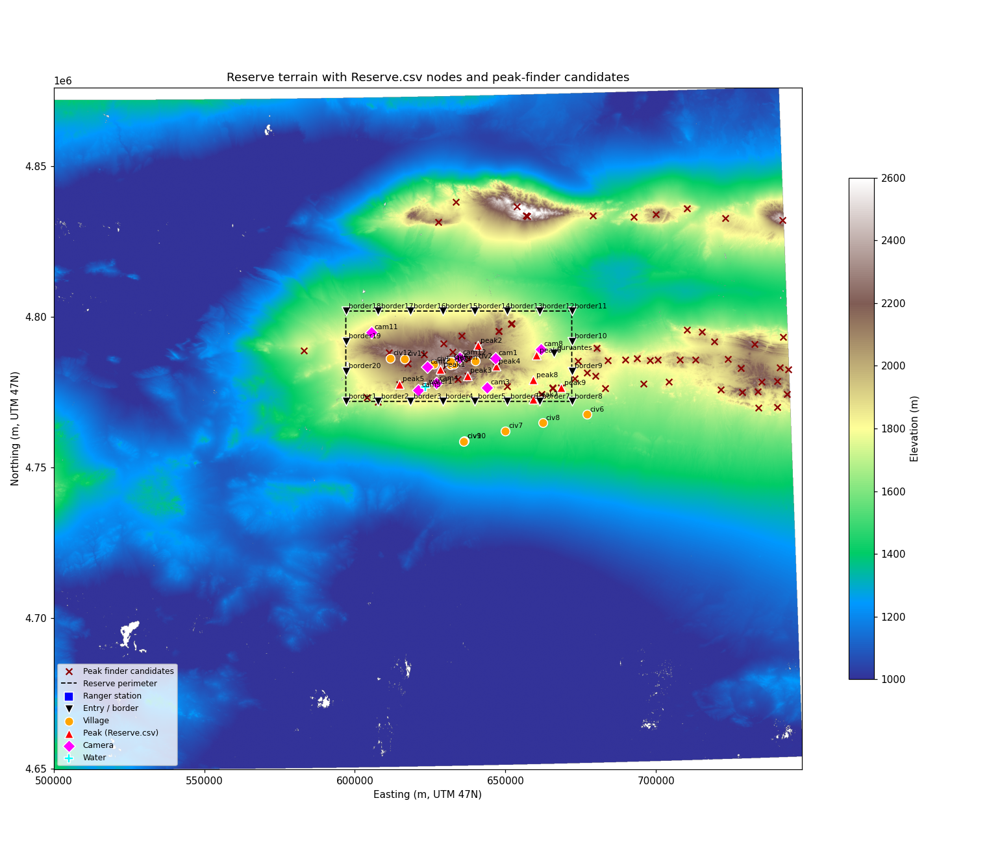
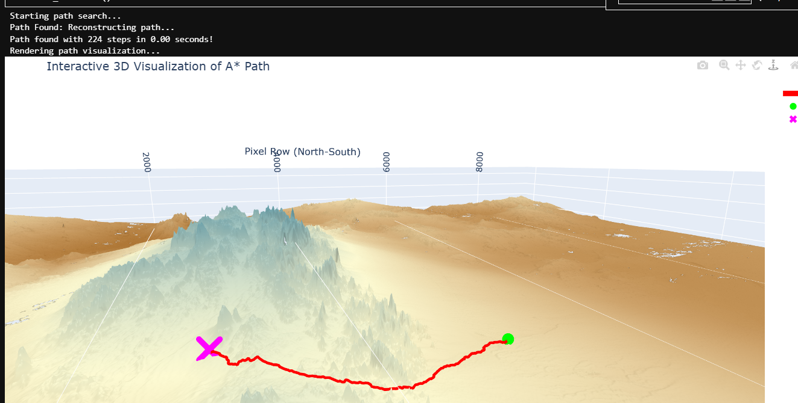

# Tost anti-poaching simulation

To what extent can simulations, RL agent knowledge and learning styles play in improving real-life decision-making and resource allocation in isolated, at-risk wildlife reserves?

A simulation of poachers and rangers in the Tost Mountains (Tost-Tosonbumba reserve, southern Mongolia), testing how agent knowledge and learning styles impact simulated performance either as a poacher infultrating a reserve, or as a defending ranger. The longer-term goal is a free or low-cost tool that understaffed reserves can use to try out patrol strategies, predict poacher activity, and use the resources at their disposal to the best of their ability.

After visiting the Tost Tosonbumba Researve in 2023, I was fascinated by the snow leopard presence as the one and only reserve soley dedicated to wild snow leopard coservation. For the record, Mongolia boasts the second highest population of snow leopards in the world. The land itself sits only 30 miles or so from the Chinese border. For a long time the area was at the mercy of competing illegal mining operations and poaching activity before it's reform as a reserve in 2016. While in school I wanted to contribute to something real and it was only until I started studying natural language processing and data science, my introduction to AI, that the wheels started turning. 

Anti-poaching tools and assistive reserve technologies I'll see in the news or conservation sites usually cost money, required technical maintance, and are most importantly re-active(For example, thermal vision drones with AI detection). With the right data and strategies, I believe reserves can shift from reactionary to prepared and informed responses. Reserves should be able to learn from past incident data, and predict activity and poacher routes based on activity levels and terrain data. If they can only afford to staff rangers with select equipment, trail cams, vehicles, and select tools like drones, something should also be able to assist management with planning the best ways they might be able to put these resources to work, where, and when.

Global statisics (2016, unfortunately no follow-up global data within the past 10 years)

- Estimated global population of approx. 4,000 wild snow leopards
- ~221-450 snow leopards are poached or killed illegally every year 
- ~90% of incidents occur in China, Mongolia, Pakistan, India and Tajikistan
- ~21% of incidents are the direct result of poaching for illegal trade 
` ~18% are non-targeted or "accidental" killings 
- ~55% of incidents are done in retaliation for livestock depredation
- ~60% of retaliatory are non-targeted killings resulting in an attempt to sell
- Leopard pelts, teeth, claws, and bones are highly saught after for trading and traditional chinese medicines.

Since 2016, a lot has changed. Protection agencies (Snow Leopard Trust, The Snow Leopard Conservation Foundation) have worked hard to build the reserve into what it is today, and they continue to heavily invest in collaborative research initiatives and livestock insurance programs to deter retaliatory killings from herders. The reserve is specifically designed around a co-management framework where locals participate directly in conservation efforts, anti-poaching initiatives, and sustainable land use. 

While incidents at Tost have dropped drastically with no official numbers being reported, proximity to the Chinese border may remain a potential risk. Historical tensions regarding land disutes and murder of conservationist Lkhagvasumberel Tumursukh was what led to the mining ban and reserve creation, but over the boarder is a different jurisdiction with their own interests and mining agenda.

Considering these circumstances and having traveled there myself, this reserve was an excellent candidate to model a simulation after. I didn't want my research to put an actively at-risk reserve at higher risk or unintentionally release sensitive data, yet at the same time historical activity validates the landscape as highly dangerous if not properly upheld.

-- 2016 report from the wildlife trade monitoring network TRAFFIC --
[TRAFFIC Article](https://www.traffic.org/what-we-do/species/leopards/)

[Assessing the Effectiveness of a Community-based Livestock Insurance Program](https://www.researchgate.net/publication/350821902_Assessing_the_Effectiveness_of_a_Community-based_Livestock_Insurance_Program)
Alexander, Justine & Agvaantseren, Bayarjargal & Gongor, Enkhtuvshin & Mijiddorj, Nadia & Piaopiao, Tang & Redpath, Stephen & Young, Juliette & Mishra, Charudutt. (2021). Assessing the Effectiveness of a Community-based Livestock Insurance Program. Environmental Management. 68. 10.1007/s00267-021-01469-8. 

-- Additional Articles --
[Article on community assisted conservation research](https://snowleopard.org/counting-gazelles-in-the-gobi/)
[Article for leopard tracking insights](https://www.einpresswire.com/article/942812801/m24-s-strange-range-a-small-cat-and-a-big-question)

## How it works

This is a research prototype. The results below come from 5 random seeds per agent and should be read with that in mind.

The reserve is a graph of 52 landmarks: 21 entry points, 12 villages, 9 summits, 8 camera sites, a water source and the ranger station manually extraced from satellite imagery and personal field notes (`data/Reserve.csv`). Given the challenging terrain and lack of official roads, Edge lengths are A* paths over a slope raster built from ALOS AW3D30 elevation data. Nodes also carry viewshed scores, centrality and  village significance. A village can better be described as any point of civilization, some being actual villages, most are 1-2 gers with a corral.


Generated reserve map

Edge traversal using A* on slope raster to navigate open wilderness terrain

The simulation runs minute by minute over many days. It has weather that changes daily, sunrise and sunset computed with The Equation of Time and reserve's location, snow and floods blocking paths, ranger shifts, and an engine table of random events (breakdowns, getting lost in the dark, herders reporting a poacher, stopping to drink tea with herders, bathroom breaks, and so on). A poacher trip starts at one of many entry points, drives to a summit, hunts for up to six hours, then has to get out. It succeeds only if it finds a leopard and escapes. It fails if it is caught (by a ranger on patrol, a herder, or someone at the station) or runs out of time (48 hours).

Agents are interchangeable "brains" behind one interface (`agents/base.py`):

- `Wanderer`: Random moves.
- `ShortestPathPoacher`: Always takes the fastest route. No learning.
- `DQNAgent`: A deep Q-network that scores each possible next move from what it knows. It starts out knowing only what is visible (positions, terrain, summits, water) and discovers villages, trail cameras and the station by arriving at them. Also capable of toggling aspects for the ablation.
- `DQNRBAgent`: The DQN plus a reasoning bank. After trips, an LLM (Claude Haiku) reads a debrief containing what the poacher itself experienced and writes a lesson as weights on six concerns, such as avoiding villages or the station area. Lessons that keep ending in capture are dropped, and after a period of training the agent depends more on it's established weights than LLM lessons .
- `PlannerRanger`: Simulated annealing agent plans a patrol from the station at the start of each shift, targeting points of interest as both the maintenance staff and guards for the reserve.

## Results

Ablation in the "realistic" world: trips start at random times, the off-duty station spots passers-by only with some probability, and headlights make poachers easier to see at night. One dawn ranger shift. The learning agents trained for 1000 simulated days (roughly 600 trips) and were then evaluated for 200 unseen days with learning switched off. Success is the mean over 5 seeds ± the standard deviation between them (how much the result varies when the same agent is trained again with a different seed).

Versions of DQN for clarity
1. "Move geometry": the agent sees, for each possible move, the edge length and progress toward its goal. 
2. "Node knowledge": adds 17 numbers about the place it would move to based on what it has learned. Visible terrain facts, what kind of place it is once discovered, known distances to villages and the station, and how often it was caught there. 
3. "threat grid": adds a 10 × 10 map of where it was caught recently.

| Agent                                                   |  Success  | Caught |  Timed out  |
|---------------------------------------------------------|-----------|--------|-------------|
| Random (`wanderer`)                                     |  7% ± 2   |   81%  |      0%     |
| Fastest route (`shortest_path`)                         |  36% ± 3  |   26%  |      0%     |
| DQN, move geometry only                                 |  30% ± 3  |   30%  |      6%     |
| DQN + road distances                                    |  28% ± 5  |   28%  |     12%     |   
| DQN + node knowledge                                    |  17% ± 10 |   30%  |     31%     |
| DQN + node knowledge + reserve-wide threat grid         |  10% ± 4  |   52%  |     25%     |
| DQN + reasoning bank (LLM lessons after every trip)     |  26% ± 7  |    5%  |     34%     |
| DQN + reasoning bank (lessons after captures/successes) |  26% ± 5  |    5%  |     32%     |

What the data supports (Welch's t-test on per-seed results, Holm-corrected across 7 comparisons):

- The DQN clearly beats Random (p < 0.001) and comes within ~5 points of the fixed fastest route.
- My hypothesis that knowledge inputs and a threat-memory grid would improve performance was not supported. Adding both to the move-only DQN cut success from 30% to 10% (p < 0.001). Taken one step at a time, node knowledge lowered it to 17% (p = 0.036, not significant after correction) and the threat grid then to 10% (p = 0.16), so with 5 seeds the drop cannot be pinned on either input alone. The knowledge agents were also very inconsistent (4% to 28% across seeds). More inputs did not mean better decisions at this amount of training.
- The reasoning bank cut captures from 30% to about 5% (p = 0.008), but the poacher became so cautious that it ran out of time far more often, so overall success did not improve. Its learning curve rose earlier (mean success over the first 500 training trips 0.238 vs 0.201), but with 5 seeds that difference is not statistically significant (p = 0.063). Lessons fed in as extra network inputs gave no speed-up; lessons applied directly to move scores did.
- The same overall pattern holds in the earlier world where every trip started at midnight, and with a second ranger shift at dusk: fastest route first, the two move-based DQNs close behind (their order swaps between worlds), knowledge and threat inputs lower, random last.

Limitations worth knowing:

- Rangers on patrol catch few poachers. A 4-hour patrol from the station only reaches the corner of a 75 × 30 km reserve near it, so most captures come from herders and the station. As built, the simulation is better at comparing poacher strategies than ranger strategies.
- Small seed size. 5 seeds per agent. Power estimate suggests ~10 are needed to settle potentially significant differences in learning-speed significance.
- Reasoning-bank penalty strength is actively being tuned.

All per-run numbers are in `analysis/runs_all.csv`, and `analysis/LAB.md` describes the analysis.

## Running it

Python 3.13 was used. Everything runs from the repository root.

```
pip install -r requirements.txt

python run_simulation.py           # One 20-day run: DQN poacher vs planning ranger, outputs in runs/
python run_ablation.py smoke       # Every agent for a few days to check settings
python run_ablation.py             # Complete ablation in parralel (taks a couple hours)
python build_dataset.py            # Results gets formatted into analysis/trips_all.csv and runs_all.csv
```

Each run writes `config.json`, `trips.csv`, `events.csv`, `tracks.csv` (positions every minute) and `summary.json`.
Same seed gives identical random results.

The reasoning-bank agents need an Anthropic API key in `ANTHROPIC_API_KEY` (and `ANTHROPIC_WORKSPACE_ID` if the key is not tied to a workspace). Without a key, `run_ablation.py` skips over them. The 10 reasoning-bank runs above made 4,688 calls and cost $1.43.

Some tests as small scripts (expected values commented):
```
python -m tests.test_learning        # verify DQN fit against a known target
python -m tests.test_blocked         # verify blocked paths and forced detours
python -m tests.test_reasoning_bank  # verify reasoning bank with a fake LLM, no API calls
```

`tests/test_llm_lesson.py` makes one real API call (a fraction of a cent).

## Rebuilding the graph

The graph in `data/` is included, so this is only needed after editing graph points of interest in `data/Reserve.csv`. The terrain rasters are not in the repository because they are large. To rebuild them, download the ALOS AW3D30 tiles N042–N043 / E099–E101 from JAXA, merge them with (`processing/merge_tiles.py`), reproject to UTM zone 47N and compute slope as the spacial derivative of elevation with GDAL. Then put `reserve_UTM47N.tif` and `reserve_slope.tif` in `processing/data/` or point `RESERVE_RASTER_DIR` at their folder, and run:

```
python -m terrain.build_graph      # needs GDAL on PATH for the viewshed step; slow (A* for every edge)
python -m terrain.check_graph
python -m terrain.plot_map         # writes data/reserve_map.png
```

If you got this far in the readme, congrats! I would just liek to point out one innovation in build_graph, surprisingly simple but very satisfying. In early stages of development reconstructing the reserve I 

## Layout

```
agents/       the brains: base interface, DQN, reasoning bank, fastest route, ranger planner
simulation/   the world: clock, weather, trips, random events, capture rules, logging
terrain/      building the landmark graph from the rasters
data/         Reserve.csv (landmarks), the built graph, a map
processing/   early terrain-processing notebook and scripts
tests/        test scripts
analysis/     analysis notes, notebook and per-run results
run_simulation.py, run_ablation.py, build_dataset.py
```

## How this was built

I designed the world, agents, experiments, and analysis. I used Claude Code (Anthropic) as a coding assistant for the runner and agent integration, verifying reproducibility, debugging, and data prep for analysis.

Original 30-M elevation data provided by JAXA (Japan Aerospace Exploration Agency), obtained in 2025.
Further data collected personally and with Google Earth satellite imagery.

I would also like to thank my data science professor, Dr. Russo, for agreeing to act as my research advisor and assisting with design decisions throughout early stages of development.

Reasoning Bank
[ReasoningBank: Enabling agents to learn from experience](https://research.google/blog/reasoningbank-enabling-agents-to-learn-from-experience/)

## What's next

Nexts steps to improve the state of this project include
- Tune Reasoning-bank penalty strength, find optimal figure
- Collecting more results data with more random seeds for a stronger analysis
- Further expansion of event engines and logic for realism
- Additional ranger specific selections for rangers to fairly compete with poacher agents
- Fine tuning of resource selection and sim world for runs:
    - number of rangers in a patrol 
    - options for vehicle selection
    - consider smart patrol time logic
    - drone and trail cam controls, footage capture logic
    - etc..
- Research into alternative RL agents not previously considered
- UI allowing visual observation of moves made, tick stepping through trips and runs
- Allow for people to compete against ranger or poacher agents, compare their stats to machine stats
- Human decision making as training data for agents, or more robust integration pipeline for historical capture data
- World cusomization with additional land/nav processing tools and logic, considerations for different geographic terrains, social contexts and conflicts, timezones and weather, different types of at-risk animals, etc..

## License
MIT. See LICENSE.
