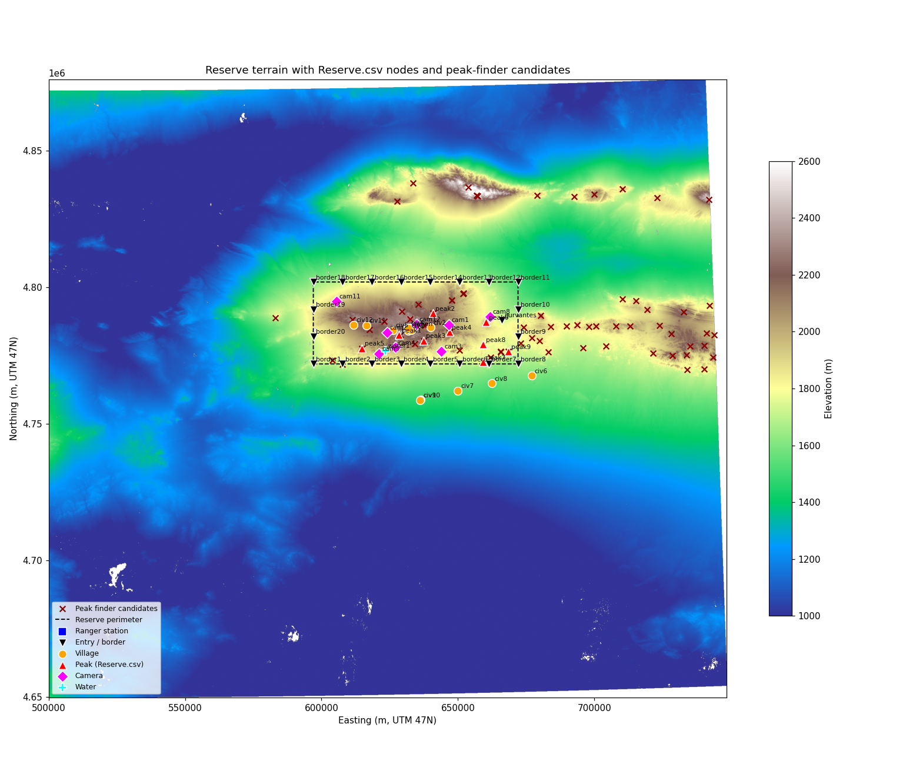
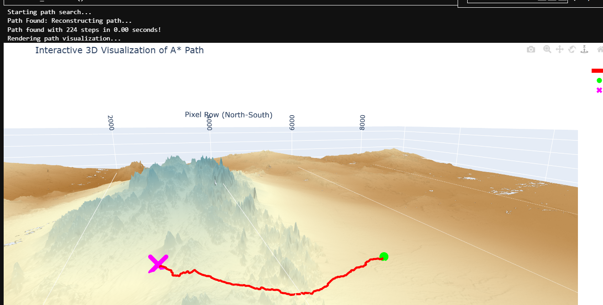

# Tost anti-poaching simulation

After visiting the Tost-Tosonbumba reserve in southern Mongolia in 2023, I kept coming back to one question. If the reserve faced renewed poaching pressure, how would a small ranger team decide where to patrol across such a large area? Many of the anti-poaching tools I’d seen focused on detecting activity as it happened. Even with that equipment, someone still had to decide where to put it and when to send a patrol. I wanted to explore whether a low-cost simulation could help reserves with limited staff and equipment test patrol decision-making ahead of time.

I started working on the idea independently and later pitched it to a professor at The College of New Jersey. Using elevation data, satellite imagery, and my field notes, I built a simulation of poachers and rangers in the Tost Mountains. In my first experiments, I used reinforcement learning to study how simulated poachers choose routes and how those choices affect the outcome of a trip. My longer-term goal is to see whether a ranger team could use the model to compare patrol plans and identify areas that are difficult to cover in a single shift. It could also be possible to use historical incident and geospatial data to predict poaching behavior, routes, and points of interception. I’ve continued the research independently since graduating.

**Where the research stands.** In my first experiments, I changed how the simulated poacher chooses its next move. In every comparison, the rangers used the same method to plan their patrols. One agent that used lessons from previous trips was caught less often, but it also ran out of time more often. The nearly complete [Part A evaluation](analysis/results_eval_part_A.ipynb) looks at that tradeoff, learning speed and how much results vary across five runs of each configuration with different random seeds.

The longer-term goal is a free or low-cost way for understaffed reserves to try out patrol strategies. Before drawing conclusions for real patrols, I want to check how closely the simulated trips, shifts and encounters resemble field operations, and whether the findings hold when those assumptions change.

<details>
<summary>Conservation background and sources</summary>

Global estimates cited in the original project background (2016)

- Estimated global population of approx. 4,000 wild snow leopards
- ~221-450 snow leopards are poached or killed illegally every year 
- ~90% of incidents occur in China, Mongolia, Pakistan, India and Tajikistan
- ~21% of incidents are the direct result of poaching for illegal trade 
- ~18% are non-targeted or "accidental" killings
- ~55% of incidents are done in retaliation for livestock depredation
- Leopard pelts, teeth, claws, and bones are highly sought after for trading and traditional chinese medicines.

My visit to Tost also drew me to the role of local herders in conservation. The sources below describe community research and livestock insurance, both relevant to understanding why conflicts with snow leopards arise. I chose this landscape because I had seen it firsthand and wanted to explore patrol planning without publishing sensitive incident records.

-- 2016 report from the wildlife trade monitoring network TRAFFIC --
[TRAFFIC Article](https://www.traffic.org/what-we-do/species/leopards/)

[Assessing the Effectiveness of a Community-based Livestock Insurance Program](https://www.researchgate.net/publication/350821902_Assessing_the_Effectiveness_of_a_Community-based_Livestock_Insurance_Program)
Alexander, Justine & Agvaantseren, Bayarjargal & Gongor, Enkhtuvshin & Mijiddorj, Nadia & Piaopiao, Tang & Redpath, Stephen & Young, Juliette & Mishra, Charudutt. (2021). Assessing the Effectiveness of a Community-based Livestock Insurance Program. Environmental Management. 68. 10.1007/s00267-021-01469-8. 

-- Additional Articles --
[Article on community assisted conservation research](https://snowleopard.org/counting-gazelles-in-the-gobi/)
[Article for leopard tracking insights](https://www.einpresswire.com/article/942812801/m24-s-strange-range-a-small-cat-and-a-big-question)

</details>

## How it works

I mapped 52 landmarks from satellite imagery and field notes: 21 entry points, 12 settlements, 9 summits, 8 camera sites, a water source and a ranger station. The data file calls the settlements “villages,” though most are one or two gers with a corral. Each landmark becomes a point in the simulation’s travel network. To estimate the distance between connected points, I used A* to trace a route over a slope map derived from ALOS AW3D30 elevation data (`data/Reserve.csv` lists the landmarks).


Generated reserve map

Edge traversal using A* on slope raster to navigate open wilderness terrain

The simulation advances one minute at a time. Weather changes daily, sunrise and sunset depend on the date and location, and snow or flooding can block a route. Events along the way can delay a trip or end it early. A poacher enters the reserve, travels to a summit, hunts for up to six hours and tries to leave. A successful trip ends with the poacher carrying a leopard out of the reserve. Other trips end in capture, an empty-handed escape or a timeout after 48 hours.

Each agent uses the same interface to choose its next move (`agents/base.py`).

- **Random movement** (`Wanderer`). The agent chooses a neighboring landmark at random.
- **Shortest path** (`ShortestPathPoacher`). The poacher follows a route to its goal using the travel distances in the graph. This provides a baseline that requires no training.
- **Deep Q-network** (`DQNAgent`). The poacher learns to score its possible next moves from trip rewards. I varied the information available to the network to test whether knowledge of landmarks or past captures helped it choose a route.
- **DQN with a reasoning bank** (`DQNRBAgent`). After selected training trips, a language model reads an account of what the poacher experienced. It assigns weights to six concerns, such as proximity to a known capture site. The agent stores these lessons. In the version tested below, they lower the scores of moves associated with those concerns.
- **Patrol planning** (`PlannerRanger`). At the start of each shift, the ranger uses simulated annealing to search for a patrol route that visits points of interest within the time available.

## Results

In the main scenario (labeled `realistic` in the data), trips start at varying times, rangers begin one shift at dawn, and headlights increase detection range at night. An off-duty ranger has a chance of spotting a passing poacher. These are assumptions built into this experiment.

The learning agents trained for 1,000 simulated days. I then turned off learning and evaluated each agent over 200 new simulated days. The table reports the percentage of finished trips with each outcome, averaged across five seeds. The ± values show the standard deviation of success rates across seeds, in percentage points. Empty-handed escapes account for the remaining trips.

The table uses three terms for the information a DQN can use:

1. "Move geometry": the agent sees, for each possible move, the edge length and progress toward its goal. 
2. "Node knowledge": adds 17 numbers about the place it would move to based on what it has learned. Visible terrain facts, what kind of place it is once discovered, known distances to villages and the station, and how often it was caught there. 
3. "threat grid": adds a 10 × 10 map of where it was caught recently.

| Agent                                                   |  Success  | Caught |  Timed out  |
|---------------------------------------------------------|-----------|--------|-------------|
| Random (`wanderer`)                                     |  7% ± 2   |   81%  |      0%     |
| Fastest route (`shortest_path`)                         |  36% ± 3  |   26%  |      0%     |
| DQN, move geometry only                                 |  30% ± 3  |   30%  |      6%     |
| DQN + road distances                                    |  28% ± 5  |   28%  |     12%     |   
| DQN + node knowledge                                    |  17% ± 10 |   30%  |     31%     |
| DQN + node knowledge + reserve-wide threat grid         |  10% ± 4  |   52%  |     25%     |
| DQN + reasoning bank (LLM lessons after every trip)     |  26% ± 7  |    5%  |     34%     |
| DQN + reasoning bank (lessons after captures/successes) |  26% ± 5  |    5%  |     32%     |

What the data supports (Welch's t-test on per-seed results, Holm-corrected across 7 comparisons):

- The move-only DQN succeeded on 30% of finished trips, compared with 7% for random movement (Holm-adjusted p < 0.001). The scripted fastest route averaged 36%.
- I expected knowledge inputs and a threat-memory grid to help. Average success fell to 17% with node knowledge and 10% with the threat grid added. With five seeds, neither individual drop survived correction for multiple comparisons.
- With lessons after every trip, the reasoning-bank agent was caught on about 5% of trips versus 30% for the move-only DQN (Holm-adjusted p = 0.010). Timeouts rose from 6% to 34%. Across the first 500 training trips, success averaged 23.8% versus 20.1%, an early advantage that remains uncertain (Holm-adjusted p = 0.189).
- The same overall pattern holds in the earlier world where every trip started at midnight, and with a second ranger shift at dusk: fastest route first, the two move-based DQNs close behind (their order swaps between worlds), knowledge and threat inputs lower, random last.

Limitations worth knowing:

- Rangers on patrol catch few poachers. A 4-hour patrol from the station only reaches the corner of a 75 × 30 km reserve near it, so most captures come from herders and the station. As built, the simulation is better at comparing poacher strategies than ranger strategies.
- Five seeds per agent left several differences uncertain.
- How strongly the stored lessons should influence each move remains an open question.

See the [per-run results](analysis/runs_all.csv) and the [Part A evaluation notebook](analysis/results_eval_part_A.ipynb). The notebook includes saved figures and results. Rerunning the trip-level analysis requires an additional file, `analysis/trips_all.csv`, which is absent from this checkout.

## Running it

Python 3.13 was used. Everything runs from the repository root.

```
pip install -r requirements.txt

python run_simulation.py           # One 20-day run: DQN poacher vs planning ranger, outputs in runs/
python run_ablation.py smoke       # Every agent for a few days to check settings
python run_ablation.py             # Complete ablation in parallel
python build_dataset.py            # Results gets formatted into analysis/trips_all.csv and runs_all.csv
```

Each run writes `config.json`, `trips.csv`, `events.csv`, `tracks.csv` (positions every minute) and `summary.json`.
The simulation seed controls random draws for events such as weather and trip starts.

The reasoning-bank agents need an Anthropic API key in `ANTHROPIC_API_KEY` (and `ANTHROPIC_WORKSPACE_ID` if the key is not tied to a workspace). Without a key, `run_ablation.py` skips over them. The 10 reasoning-bank runs above made 4,688 calls and cost $1.43.

Some tests as small scripts (expected values commented):
```
python -m tests.test_learning        # verify DQN fit against a known target
python -m tests.test_blocked         # verify blocked paths and forced detours
python -m tests.test_reasoning_bank  # verify reasoning bank with a fake LLM, no API calls
```

`tests/test_llm_lesson.py` makes one real API call (a fraction of a cent).

## Rebuilding the graph

The graph in `data/` is included, so this is only needed after editing graph points of interest in `data/Reserve.csv`. The terrain rasters are not in the repository because they are large. To rebuild them, download the ALOS AW3D30 tiles N042–N043 / E099–E101 from JAXA, merge them with (`processing/merge_tiles.py`), reproject to UTM zone 47N and compute slope as the spatial derivative of elevation with GDAL. Then put `reserve_UTM47N.tif` and `reserve_slope.tif` in `processing/data/` or point `RESERVE_RASTER_DIR` at their folder, and run:

```
python -m terrain.build_graph      # needs GDAL on PATH for the viewshed step; slow (A* for every edge)
python -m terrain.check_graph
python -m terrain.plot_map         # writes data/reserve_map.png
```

## Layout

```
agents/       code for choosing poacher moves and planning ranger patrols
simulation/   the world: clock, weather, trips, random events, capture rules, logging
terrain/      building the landmark graph from the rasters
data/         Reserve.csv (landmarks), the built graph, a map
processing/   early terrain-processing notebook and scripts
tests/        test scripts
analysis/     analysis notes, notebook and per-run results
run_simulation.py, run_ablation.py, build_dataset.py
```

## How this was built

I designed the world, agents, experiments, and analysis. I used Claude Code (Anthropic) as a coding assistant for the runner and agent integration, verifying reproducibility, debugging, and data prep for analysis.

Original 30-M elevation data provided by JAXA (Japan Aerospace Exploration Agency), obtained in 2025.
Further data collected personally and with Google Earth satellite imagery.

I would also like to thank my data science professor, Dr. Russo, for agreeing to act as my research advisor and assisting with design decisions throughout early stages of development.

Reasoning Bank
[ReasoningBank: Enabling agents to learn from experience](https://research.google/blog/reasoningbank-enabling-agents-to-learn-from-experience/)

## What's next

Next steps include
- Repeat the comparisons with 10 seeds per agent configuration to better estimate variation across runs.
- Test whether the reasoning-bank penalty carries too much weight once exploration becomes infrequent. Compare the current setting with weaker and zero penalties under the same world rules and training budget.
- Compare simulated trip and patrol durations with field observations where available.
- Test how patrol outcomes change when rangers can choose different routes and shift times.
- Fine tuning of resource selection and sim world for runs:
    - number of rangers in a patrol 
    - options for vehicle selection
    - alternative patrol schedules
    - drone and trail cam controls, footage capture logic
    - etc..
- Research into alternative RL agents not previously considered
- UI allowing visual observation of moves made, tick stepping through trips and runs
- Allow for people to compete against ranger or poacher agents, compare their stats to machine stats
- Human decision making as training data for agents, or more robust integration pipeline for historical capture data
- World customization with additional land/nav processing tools and logic, considerations for different geographic terrains, social contexts and conflicts, timezones and weather, different types of at-risk animals, etc..

## License
MIT. See LICENSE.
